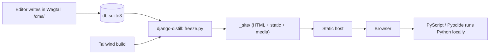

<div align="center">

```
 ____        __     __
|  _ \ _   _ \ \   / /__ _ __ ___  ___
| |_) | | | | \ \ / / _ \ '__/ __|/ _ \
|  __/| |_| |  \ V /  __/ |  \__ \  __/
|_|    \__, |   \_/ \___|_|  |___/\___|
       |___/        write it. run it. watch it run.
```

**A Python learning site where every line of code can be stepped through.**
Built with Django + Wagtail. Shipped as plain static files. No servers, no logins, no tracking.


</div>

---

## The idea in 30 seconds

Most practice sites tell you **whether** your code is right. PyVerse also shows you **why** a solution works.

```
   ┌─────────────┐      ┌──────────────┐      ┌───────────────────┐
   │  Read the   │ ───▶ │  Solve it in │ ───▶ │  Watch the        │
   │  problem    │      │  the browser │      │  reference solution│
   │  /practice/ │      │  (Pyodide)   │      │  run, line by line │
   └─────────────┘      └──────────────┘      │  (same page)       │
                              ▲               └─────────┬─────────┘
                              └── edit the call, trace again ◀┘
```

- **Practice** — LeetCode-style problems that are graded entirely in your browser.
- **Labs** — free-run playgrounds (the tracer today; pandas, numpy and others later). Paste any program, trace it with `sys.settrace`, see every executed line, every variable and a memory graph. Not tied to a problem.
- **The loop** — each problem page has a *Watch this solution run* panel that traces the reference solution on one example, on the same page. Solve, then step through it.
- **Learn** — tracks → courses → lessons, with quizzes.
- **Notes** — a small blog for longer write-ups.

Everything interactive runs in the visitor's browser. The server only exists on the author's machine while writing content.

---

## How it works (the unusual part)

PyVerse is **two programs sharing one repo**:

| | **Authoring** | **Production** |
|---|---|---|
| Runs on | the author's laptop | any static host |
| What | Django + Wagtail admin + SQLite | HTML, CSS, JS files |
| Who uses it | one editor | everyone |
| Code execution | none | in each visitor's browser (PyScript / Pyodide) |
| Progress & results | — | `localStorage`, on the visitor's device |



Consequences you can rely on:

- **No server-side code execution.** Learner code never leaves their tab.
- **No accounts in production.** Login/signup are authoring-time scaffolding and are hidden from the export (`SHOW_ACCOUNT_LINKS = False`).
- **One enumeration, two outputs.** `pyverse/seo.py` decides which pages are *live*; the sitemap and the export both read from it, so they cannot drift apart.

---

## Map of the repo

```
config/                Django settings (base / local / test / distill) and URLs
pyverse/
├── home/              Home, About, shared SEO fields
├── lms/               Learn: Track → Course → Lesson pages
├── topics/            Practice hub, topic pages, sheets; serves /practice/problem/<slug>/
├── coding/            CodingProblem snippet: tests, hints, editorial, reference solution
├── quiz/              Quiz pages + client-side scoring
├── labs/              Labs: free-run playgrounds (LabPage); the tracer runtime is shared with problem pages
├── puput/             Vendored blog for /python/notes/
├── ai_content/        Optional LLM-assisted drafting + out-of-process answer-key verifier
├── users/ theme/ common/   Auth scaffolding (authoring only), Tailwind, shared blocks
├── freeze.py          What gets written to _site/
├── seo.py             Sitemap, robots, canonical URLs, JSON-LD, "what is live"
├── templates/  static/
docs/                  Sphinx docs; docs/design/ holds the decision records
neetcode/ temp/        Original standalone prototypes (kept for reference)
tests/                 Project-level tests (app tests live beside each app)
```

Page tree in the CMS:

```
Home
├── Learn  (LMSIndexPage)  → Track → Course → Lesson
├── Practice (PracticeHubPage) → Topic pages, Sheets   ·  Problems are snippets
├── Labs   (LabsIndexPage) → LabPage …                 ·  free playgrounds
└── Python notes (blog)
```

---

## Quick start

**You need:** Python 3.14, [`uv`](https://docs.astral.sh/uv/), and Node only if you rebuild Tailwind from source via the `django-tailwind` tooling.

```bash
git clone https://github.com/uditbaliyan/pyverse.git
cd pyverse

uv sync --locked                       # exact, reproducible environment

# local config: copy the templates, then edit values
cp -r .envs.example/. .envs/ 2>/dev/null || true   # see ".envs.example/" for the shape

uv run python manage.py migrate
uv run python manage.py createsuperuser

# two terminals:
uv run python manage.py runserver
uv run python manage.py tailwind start
```

Open <http://localhost:8000/> for the site and <http://localhost:8000/cms/> to author.

> The repo ships `db.sqlite3` history from early development. Treat your local database as the only copy of your content and back it up.

### Run the checks

```bash
uv run pytest                     # unit + page + command tests
uv run ruff check .               # lint
uv run mypy pyverse               # types
uv run python manage.py makemigrations --check --dry-run \
    home lms quiz coding topics puput labs users
```

---

## Build the static site

```bash
uv run python manage.py tailwind build          # first, always — the stylesheet is gitignored build output

DJANGO_SETTINGS_MODULE=config.settings.distill \
PYVERSE_CANONICAL_BASE_URL=https://your-domain.example \
uv run python manage.py distill-local _site --collectstatic --force
```

`_site/` is the whole product: upload it to Netlify, Cloudflare Pages, GitHub Pages, or any bucket. It contains `sitemap.xml`, `robots.txt`, `404.html`, `_redirects`, and one `index.html` per live page.

Quick sanity checks before you upload:

```bash
grep -rl '/accounts/' _site --include=*.html | wc -l          # expect 0
test -f _site/sitemap.xml && test -f _site/404.html && echo ok
```

---

## The practice → trace loop

This is the part that makes PyVerse different from "a site with a code box".

1. **A problem** (`CodingProblem`) has a function name, starter code, test cases (some hidden), hints, an editorial and a **reference solution**.
2. The problem page's **▶ Watch this solution run** panel (`includes/trace_panel.html`, `static/js/problem-trace.js`) traces the reference solution on one visible example, in the learner's browser. The example is the problem's `trace_case` (1-based among visible cases) or, if unset, the first visible case.
3. **`check_problem_traces`** is the quality gate. For every problem it checks, out of process with the same tracer that ships to the browser: the solution passes all tests; the traced call *returns* the answer key under the problem's comparator; the trace fits the step cap and is between `MIN_STEPS` (6) and `MAX_STEPS` (250) steps. Errors exit 1; warnings only with `--strict`.
4. Nothing is published by the command; it reports, and `--apply` only pins `trace_case` where it is unset. The admin problem list shows each problem's trace status.

```bash
uv run python manage.py check_problem_traces                      # all problems
uv run python manage.py check_problem_traces --slug two-sum       # one (repeatable)
uv run python manage.py check_problem_traces --report             # one table row per problem
uv run python manage.py check_problem_traces --apply              # pin the best example where unset
uv run python manage.py check_problem_traces --strict             # warnings fail too
```

Optional teaching layer (CMS → Coding Problem): **Trace notes** (a sentence of *why* shown when the trace reaches a line) and **Predictions** (a question with a *Reveal answer* button). Both refer to lines of the reference solution, need a pinned **Trace example**, and appear only while the reference is traced on exactly that call. `check_problem_traces` warns about notes on lines the example never runs. Design: `docs/design/labs.rst`.

Authoring checklist for a problem that traces well:

- Mark at least one small example **not hidden**; the traced example is always a visible one.
- Name the solution function exactly as `function_name`.
- Prefer a reference solution a beginner can follow over the cleverest one.
- Pin a **Trace example** (or run `check_problem_traces --apply`) if you add notes or predictions.
- Run `check_problem_traces --report` before publishing.

---

## Writing content

| I want to… | Do this |
|---|---|
| Add a problem | CMS → Snippets → **Coding Problems** → Add. Attach it to a Practice topic. |
| Add a lesson | CMS → Pages → Learn → Track → Course → add Lesson. |
| Add a quiz | Under Practice (quizzes are pages). |
| Add a lab by hand | CMS → Pages → Labs → add **Lab Page** (paste a program; labs are free playgrounds, not tied to a problem). |
| Draft with an LLM | `uv run python manage.py ai_create` — pick a type, describe it, review the draft. |
| Redirect an old URL | Wagtail Redirects. The export writes both HTML stubs and `_redirects`. |

### AI-assisted drafting (optional)

`ai_create` drafts a problem, blog post, lesson or quiz. For problems, generated answer keys are **executed in a subprocess against the reference solution** (`ai_content/verify.py`) so a hallucinated expected output can't silently mark correct learners wrong. Configure the provider with `AI_API_KEY` or the provider's usual variable (`OPENAI_API_KEY`, `ANTHROPIC_API_KEY`, …). Generated content is a draft; a human publishes it.

---

## Configuration

| Variable | Used by | Meaning |
|---|---|---|
| `DJANGO_SETTINGS_MODULE` | everything | `config.settings.local` (dev), `.test`, `.distill` (export) |
| `PYVERSE_CANONICAL_BASE_URL` | export | Origin for canonical links, OpenGraph URLs and `sitemap.xml` |
| `DJANGO_SECRET_KEY` | local/authoring | Generate your own; never commit it |
| `DJANGO_ADMIN_URL` | authoring | Custom admin path |
| `AI_API_KEY` / provider key | `ai_create` | Only if you use AI drafting |

Real `.envs/` files and `*.sqlite3` are gitignored. Start from `.envs.example/`.

---

## Sharp edges (learned the hard way)

- **`.gitignore` and generic words.** A bare `tags` rule once swallowed `templates/puput/tags/` and made fresh clones fail to export. Anchor patterns (`/tags`).
- **Build the CSS first.** `dist/styles.css` is generated; a stale one silently ignores new classes.
- **A rendered page ≠ a working feature.** After changing the practice engine, solve a problem in a real browser, not just the test client.
- **The export is the product.** If `distill-local` fails, nothing ships — run it in CI, not only on your machine.
- **Tracing has a cap.** Long loops are truncated by design so a runaway can't flood the page.

---

## Status

| Area | State |
|---|---|
| Static export, sitemap, canonicals, redirects, 404 | working, verified |
| Practice (browser grading) | working |
| Labs (line trace + memory graph) | working |
| Practice → trace loop (same page) | working; content is the bottleneck |
| Learn (tracks/courses/lessons) | early |
| Accounts / sync | intentionally absent in production |
| Ads | not implemented |

PyVerse is an early-stage personal project. The engine is ahead of the content; the next milestone is a few dozen *good* problems, each with a trace.

---

## FAQ

**Why static?** Zero hosting cost, nothing to patch, nothing to attack, and pages that are fast everywhere. The only thing a server would add is cross-device progress, and that isn't worth running one for yet.

**Why not run code on a server?** It would need sandboxing, quotas and abuse handling. Pyodide gives each learner a private interpreter for free.

**What if a learner writes an infinite loop?** Today the page can hang until the tab is closed or reloaded. Moving execution into a worker with a kill timer is on the roadmap.

**Can I add accounts later?** Possible, but that changes the project's nature (servers, email, moderation). Prove it's needed first.

**Is it only for beginners?** Syntax-level basics are covered, but the practice track is aimed at people preparing for coding interviews in Python.

---

## Documentation

`docs/` is a Sphinx site. Serve it with:

```bash
cd docs && uv run make livehtml
```

Design records worth reading first: `static-export.rst`, `grading-engine.rst`, `labs.rst`, `page-tree.rst`, `progress-tracking.rst`, `tag-taxonomy.rst`.

---

## Contributing

Issues and small pull requests are welcome. Before opening one:

```bash
uv run pytest && uv run ruff check .
```

Keep changes focused; if you touch the export, include a test that builds into a temp directory and checks every sitemap URL has a file.

---

## License

MIT © Udit Baliyan. See [`LICENSE`](LICENSE).

<div align="center"><sub>Made with Python, a tracer, and a stubborn belief that you learn code best by watching it run.</sub></div>
